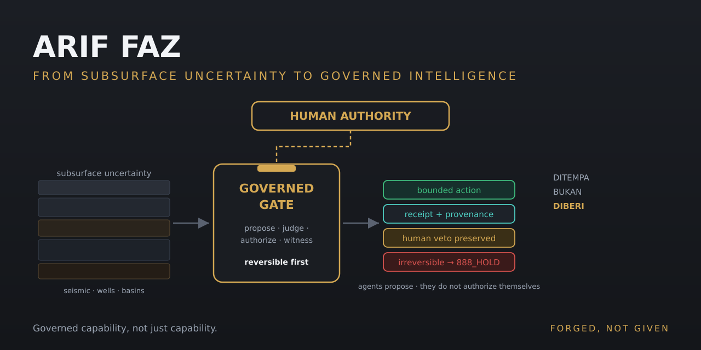

<p align="center">
  
</p>

# ARIF FAZ

### Exploration geoscientist building governed intelligence.

**DITEMPA BUKAN DIBERI · Forged, Not Given**

I am Arif, a geologist by training and a systems architect by necessity.

After 11 years in exploration geoscience — seismic, wells, basins — I began building something different: a constitutional AI system that treats intelligence the way geology treats uncertainty. The subsurface is incomplete. Judgment must still hold.

I now apply that discipline to AI systems:

> **Intelligence must be governed before it acts.**

## What I build

My core work is **arifOS**, a federated runtime that separates:

- intelligence from authority
- attention from judgment
- judgment from execution
- execution from witnessing
- memory from narrative

Agents may propose. They do not authorize themselves.
Humans retain the final veto.
Consequential actions produce inspectable receipts.

```text
Human intent
    ↓
AAA prioritizes
    ↓
arifOS judges (666 JUDGE)
    ↓
A-FORGE executes after authorization (777 FORGE)
    ↓
FRAME witnesses · VAULT999 preserves the record (999 SEAL)
```

**Priority is not authority. Capability is not permission.**
(`888_HOLD` remains the sovereign-escalation verdict when irreversible consent is needed.)

## Enter the federation

- [arifOS](https://github.com/ariffazil/arifOS) — authority and constitutional judgment
- [AAA](https://github.com/ariffazil/AAA) — attention and agent discovery
- [A-FORGE](https://github.com/ariffazil/A-FORGE) — governed execution
- [GEOX](https://github.com/ariffazil/GEOX) — earth and subsurface intelligence
- [arif-fazil.com](https://arif-fazil.com) — public entry point

The full map (all organs, boundary services, memory and metabolism planes) lives in the federation repository — this page is a doorway, not a directory.

## Connect in 30 seconds

```json
{
  "mcpServers": {
    "arifos": { "url": "https://mcp.arif-fazil.com/mcp" },
    "geox":   { "url": "https://geox.arif-fazil.com/mcp" }
  }
}
```

Probe the public authority surface:

```bash
curl -s https://mcp.arif-fazil.com/health | jq .
```

Public endpoints expose bounded capabilities. Mutation remains subject to identity, authority and runtime governance.

## Why this exists

Most AI systems optimize capability. I focus on governed capability:

- Who authorized the action?
- What must remain untouched?
- Which evidence supported the decision?
- What consequence actually occurred?
- Can a human still refuse?

## Working principles

- Name uncertainty early.
- Preserve provenance.
- Do not confuse elegance with truth.
- Witness before mutation.
- Prefer reversible action.
- Keep human veto final.
- Record consequences, not just intentions.

## Boundaries

Personal relationships, family reality and private life records are not published in these repositories.

Public code is not personal memory. A representation of a person is not the person.

## Start here

- [Federation architecture](FEDERATION.md)
- [Constitutional canon](CANON.md)
- [Repository index](INDEX.md)
- [Current verified state](https://arif-fazil.com/governance/)
- [Security and disclosure](SECURITY.md)

## External Footprint & Discovery

arifOS is publicly discoverable beyond first-party domains.

- **Discoverable:** YES (GitHub, PyPI, MCP Directories, External Catalogs)
- **Installable:** YES (`pip install arifos`)
- **Inspectable & Forkable:** YES
- **Independent Validation:** NOT YET ESTABLISHED

*Discoverability should not be interpreted as endorsement, certification, commercial adoption, or proof of effectiveness.*

Canonical Ledger: [EXTERNAL_WITNESS_LEDGER.md](https://github.com/ariffazil/arifOS/blob/main/docs/EXTERNAL_WITNESS_LEDGER.md)

## Contact

- Website: [arif-fazil.com](https://arif-fazil.com)
- LinkedIn: [Arif Fazil](https://linkedin.com/in/ariffazil)
- Email: arifbfazil@gmail.com

**DITEMPA BUKAN DIBERI · Forged, Not Given**
