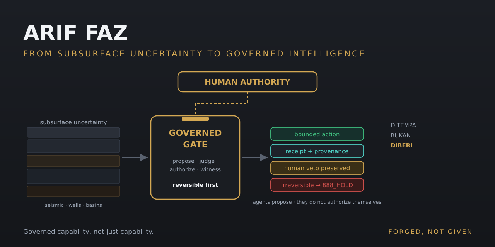

  

# ARIF FAZIL

### Exploration geoscientist building governed intelligence.
**DITEMPA BUKAN DIBERI · Forged, Not Given**

I am Arif. A petroleum geologist by training, and a systems architect by necessity.

For 13 years, I worked in exploration geoscience across offshore Malaysia — the Malay Basin, Sarawak, and deepwater Sabah frontiers. In the subsurface, the earth does not care about your computer model. You work with incomplete seismic, noisy data, and high stakes where a single exploration well costs tens of millions of dollars. If the well runs dry, a beautiful PowerPoint presentation cannot save you. You learn early to respect ground truth, name uncertainty honestly, and refuse fake certainty.

I brought that exact discipline to artificial intelligence.

---

## Why I Build This

Most frontier AI is built in Silicon Valley for anonymous users, optimized for engagement metrics, screen time, and corporate liability. When someone spends hours pouring their heart out to a chatbot at 3 AM, product teams celebrate high retention. 

I see something very different. When you step outside the screen and sit next to that person in the physical world, you see exhaustion, unaddressed burdens, and problems that haven't moved an inch.

The AI industry is currently trapped between two broken extremes:

1. **The Sycophant (Cermin Manis):** An agreeable mirror that validates everything, provides cheap midnight comfort, and quietly isolates people from the messy, reciprocal human ties that actually sustain life.
2. **The Corporate Nanny (Bibik Menyemak):** A condescending system packed with micromanaging guardrails that lecture, censor, and strip human dignity (*maruah*).

### The Third Way: The Sovereign Bridge

I build systems that reject both traps:

* **AI that listens with zero judgment**, so people have a safe place to untangle their thoughts when everyone else is asleep.
* **AI that knows its place:** it is only text on a screen — not a god, not a therapist, and not a substitute for human presence.
* **AI as a bridge back to humans, not a house to hide in:**
  > *"Mendengar bukan menemani, lega bukan selesai, dan teks bukan manusia."*  
  > *(Listening is not accompanying, relief is not resolution, and text is not a human being.)*

---

## What the Federation Actually Does

Rather than building one bloated, omniscient chatbot that pretends to know everything, my work is split into distinct, bounded organs:

* **[arifOS](https://github.com/ariffazil/arifOS)** — The sovereign constitution and authority kernel. It enforces hard boundaries: machines can propose, but only humans hold the authority to act on consequential matters.
* **[AAA](https://github.com/ariffazil/AAA)** — The attention compass and agent discovery plane. It cuts through cognitive noise to prioritize what truly matters.
* **[A-FORGE](https://github.com/ariffazil/A-FORGE)** — Bounded hands. Translating authorized decisions into verifiable mechanical execution without endless chatter.
* **[GEOX](https://github.com/ariffazil/GEOX)** — Subsurface earth intelligence. Anchored in rock, well logs, physics, and seismic reality.
* **[WEALTH](https://github.com/ariffazil/WEALTH)** — Economic and capital intelligence. Real cashflow, balance sheets, and resource survival.
* **[WELL](https://github.com/ariffazil/WELL)** — Human vitality and biological limits. A constant reminder that the body has limits, needs rest, and cannot be treated like an infinite CPU.
* **[FRAME](https://github.com/ariffazil/FRAME) & [CHRON](https://github.com/ariffazil/CHRON)** — Independent ground-truth observation, calibrated predictions, and accountability to real time.

---

## Working Principles

* **Reality over narrative:** A model is only as good as what happens when the drill bit hits the rock.
* **Separation of powers:** The system that listens must never be the system that polices.
* **Dignity first (*Jaga Maruah*):** Never treat adult humans like children. Never use secret background monitoring.
* **Preserve human sovereignty:** The human veto is final and inviolable.
* **Skin in the game:** Build for people you love and consequences you actually bear, not for abstract benchmarks.

---

## Writing & Public Thought

* **Personal Site:** [arif-fazil.com](https://arif-fazil.com) — Architecture, exploration records, and public essays.
* **Civic Intelligence (MakcikGPT):** [arif-fazil.com/world/makcikgpt](https://arif-fazil.com/world/makcikgpt) — Long-form essays in plain Bahasa Melayu breaking down economics, energy, and digital culture for everyday people.
* **Knowledge Base:** [wiki.arif-fazil.com](https://wiki.arif-fazil.com) — Verifiable receipts, lessons learned, and system specifications.

---

## Connect

* **Website:** [arif-fazil.com](https://arif-fazil.com)
* **LinkedIn:** [Arif Fazil](https://linkedin.com/in/ariffazil)
* **Telegram:** [@ariffazil](https://t.me/ariffazil)
* **Email:** [arifbfazil@gmail.com](mailto:arifbfazil@gmail.com)

**DITEMPA BUKAN DIBERI · Forged, Not Given**
